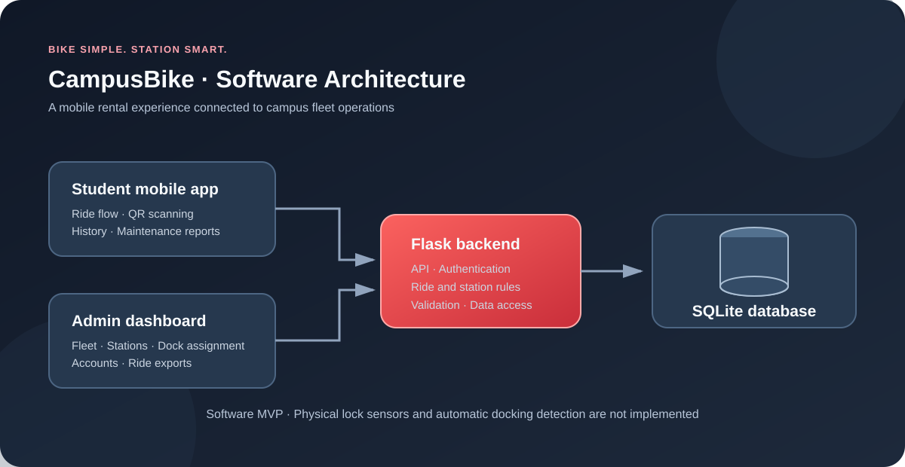

# CampusBike — software MVP 1.0.1

**Bike simple, station smart.**

Campus bicycle sharing: Expo/React Native mobile app, Flask administration and
SQLite backend. This release packages the software MVP for demonstration,
maintenance or handover. It is **not a deployed service, signed mobile app, or
finished physical smart-dock system**.

## Project at a glance

CampusBike explores how a campus can manage bicycle rentals, returns, stations,
docking assignments, maintenance reports, and fleet visibility through a shared
software system.

## System architecture

*The diagram shows the software components. Physical smart locks, lock sensors,
and automatic dock detection are not implemented in this MVP.*

## Start here

- [Installation and upgrade](docs/SETUP.md)
- [Operator guide and backup/restore](docs/OPERATIONS.md)
- [Architecture, features and handover](docs/HANDOVER.md)
- [Release verification and remaining limitations](docs/RELEASE.md)
- [System architecture diagram source](docs/architecture.svg)

## Included

- Student password authentication, native secure token storage, session expiry,
  logout and account management.
- Mobile station map, foreground location, bike QR scanning, My Ride timer,
  personal history, maintenance reporting and profile/logout.
- Exact numbered return-dock assignment with server-side GPS checks, ten-minute
  reservations, cancellation and recovery after restart.
- Retry-safe return completion: repeating confirmation returns the saved receipt
  without ending a later ride or incrementing the count again.
- Admin station names/sponsors, coordinates/service-area polygon, QR labels,
  fleet/rebalancing, maintenance, student accounts and CSV ride export.
- Disposable-database tests, client session tests, locked dependencies,
  configuration bootstrap, WSGI server, backup/restore and consistency audit.

## Boundaries and limitations

Physical presence, bike identification and lock sensors are **not implemented**.
The confirmation button simulates docking, and a software `Locked` value does
not prove a real lock is closed. Phone-provided GPS can be spoofed. No background
fleet tracking, recorded journey distance, payments, advertising marketplace,
full multi-campus tenancy, or mobile Google sign-in is included. The legacy
Google web portal is read-only for rental/return actions.

## Repository map

| Path | Purpose |
|---|---|
| `campusbike_v2/` | Supported backend and admin application |
| `CampusBikeMobile/` | Supported native mobile application |
| `docs/` | Setup, operations, handover, verification and diagrams |
| `scripts/check.sh` | Run backend and client checks |
| Root SQL, `CasosDeUso/`, `IMG/`, historical patch scripts | Legacy material, not runtime dependencies |

The previous root README is preserved in
[legacy-database-project.md](docs/legacy-database-project.md), including its
original attribution. Ownership/licensing of legacy material and third-party
assets has **not** been verified; this release does not establish transfer rights.
Do not run old patch scripts against this release.
